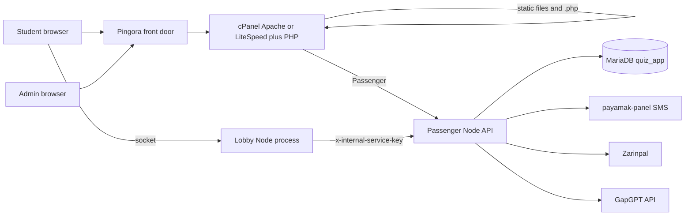
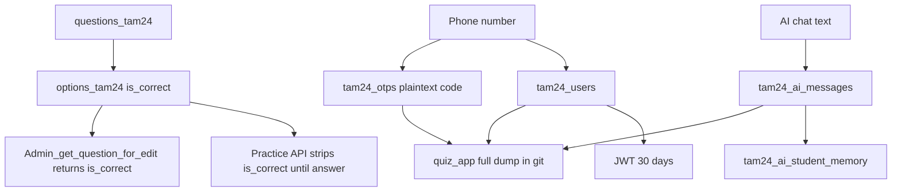

# Project architecture

Reviewed commit: `0ac668a` on `main`. The running site is not this document’s branch.

## What this repository is

One Vite + React SPA (`metatest/`) and two Node processes:

- `metatest/src/backend/server.js` — Express API (students, admin, payments, AI, internal quiz grading).
- `metatest/realtime-lobby-service/` — Socket.IO lobby. HTTP surface is `GET /health` plus the socket.

There is no Next.js app, no WordPress, no PHP application, and no blog in this repo. `next-themes` is a theme helper only. A separate marketing site or CMS was not found here. UNKNOWN whether some other hostname on the same cPanel account is WordPress. `metatest.app` itself, from the static `index.html` and this code, is this SPA.

The repo root also contains a second unpacked copy (`src/`, `views/`, `admin/`, `api/`) that `npm run build` does not compile. It had its own `.env` files (SEC-001).

## Trust boundaries

PHP and Node share the account. Uploads land in `public/`, which is the directory Express calls the web root and the directory cPanel is likely to serve. That shared folder is the RCE boundary (SEC-007).

## PII and exam data

## Browser routes

`metatest/src/App.tsx` lines 691–697.

| Path | UI | Auth in the page |
| --- | --- | --- |
| `/*` | Main student app (dashboard, quiz, profile, AI) | Client reads `auth_token` / `token` cookies |
| `/admin/*` | Admin panel | Expects `admin_token` cookie. API still requires a user token on `main` |
| `/re/*` | Plan purchase | User token |
| `/payment/result/:token` | Payment result | HMAC token in the URL, not a session |
| `/lobby/:shareCode`, `/quiz/:quizId`, `/result/:resultId` | Inside `MainApp` | User token |

## HTTP API

Auth column is what `main` actually enforces, not what the UI intends.

| Method and path | Auth | Role | Data |
| --- | --- | --- | --- |
| `POST /api/flow` | `requireToken`, except actions below | Whatever the token says | Multiplexed student and admin actions |
| actions `send_otp`, `verify_otp`, `password_login`, `admin_login` | Public | none | Phone, OTP, or admin password |
| `POST /api/upload_avatar` | `requireToken` | session user | Writes `public/avatars` |
| `POST /api/reset-avatar` | `requireToken` | session user | Clears avatar |
| `GET /api/payments/plans` | Public | none | Prices |
| `POST /api/payments/discount/validate` | `requireToken` | session | Coupon |
| `POST /api/payments/create` | `requireToken` | session | Creates a payment |
| `GET /api/payments/me` | `requireToken` | session | Plan status |
| `GET /api/payments/zarinpal/callback` | Public | none | Gateway return |
| `GET /api/payments/result/:token` | HMAC in the path | none | Payment status |
| `GET /api/dashboard/data` | `requireToken` | session | Dashboard |
| `POST /api/dashboard/claim-reward` | `requireToken` | session | XP |
| `POST /api/dashboard/referrer-code` | `requireToken` | session | Referral |
| `GET /api/dashboard/tour-status` | `requireToken` | session | Tour flag |
| `POST /api/dashboard/tour-viewed` | `requireToken` | session | Tour flag |
| `POST /api/dashboard/update-task-progress` | `requireToken` | session | Manual tasks 8–10 |
| `GET /internal/quizzes/:quizId/metadata` | Internal key, or open if key empty and not production | service | Quiz metadata |
| `POST /internal/quizzes/:quizId/members` | same | service | Membership |
| `POST /internal/quizzes/:quizId/grade` | same | service | Grades answers |
| `POST /internal/quizzes/:quizId/finish` | same | service | Finishes quiz |
| `POST /internal/results` | same | service | Saves a result |
| `/api/ai-teacher/*` | `requireToken` on the router | session | Chat, files, wallet |

`/api/flow` actions include profile, guest login, quiz practice, favorites, notes, review, reports, quiz-world create/submit, and every `Admin_*` action. Admin mutations are listed in SEC-005. They are not a separate mounted admin router.

## Lobby

Socket.IO verifies `JWT_SECRET` (`realtime-lobby-service/src/services/auth.service.ts`). `GET /health` is public and returns status only. The process calls the API with `x-internal-service-key`.

## Hosting placement

Shared cPanel at Pars Web Server. PHP is enabled. Node is Passenger. No staging. Details and the `.htaccess` to add are in `infrastructure-audit.md`.
